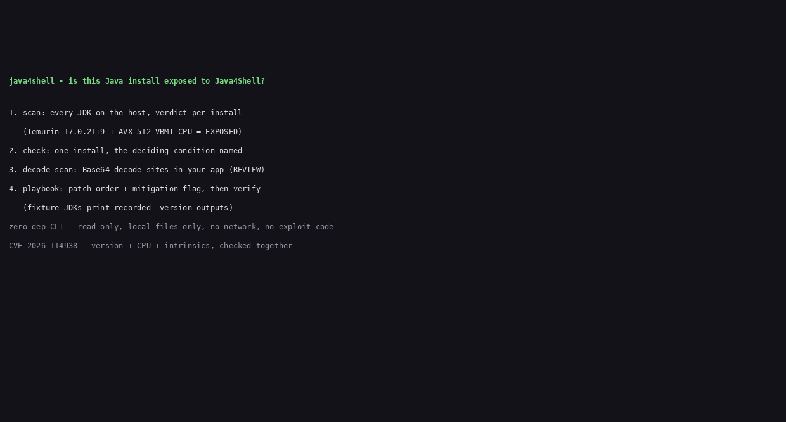

# java4shell

Is this Java install actually exposed to Java4Shell (CVE-2026-114938)? A zero-dependency CLI that answers from the three live conditions together: JDK patch level, CPU AVX-512 VBMI, and the Base64 fast path.

## Why

Java4Shell is a heap out-of-bounds write in the HotSpot AVX-512 Base64 decoder, disclosed 17/11/2026 by Calif (CVE-2026-114938, CVSS 4.0 9.2 Critical / CVSS 3.1 8.1 High). A 65-byte crafted Base64 input makes the decoder write 62 bytes past its heap output buffer. Calif demonstrated pre-auth RCE on default configs of Keycloak, Jira, Confluence, JFrog Artifactory, Jenkins and PingFederate. Fixed builds shipped the same day: 17.0.21.1, 21.0.13.1, 25.0.5.1, 27.0.1.1.

The flaw is in the runtime, not in any library. A dependency scan of `pom.xml` or an SBOM finds nothing, and a version-only CVE match calls a host "vulnerable" even when its CPU has no AVX-512 VBMI. Exposure needs all three conditions together, on the host the JVM runs on:

1. An affected patch level (OpenJDK 17.0.6 and later, lines 21, 25, 27).
2. An x86-64 CPU with all four flags: `avx512f`, `avx512bw`, `avx512vbmi`, `bmi2`.
3. The Base64 fast path switched on (the default, unless `-XX:-UseBASE64Intrinsics`).

`java4shell scan` checks all three, per install, with a CI gate. No CVE database, no network, no exploit code. It never runs the crashing input against a live JVM.

As of 18/11/2026 there are no reports of exploitation in the wild, and the CVE is not in the CISA KEV catalog. Calif published a safe trigger-only reproducer; no weaponised public exploit exists, and the per-product exploits are withheld. This tool does not claim otherwise.

## Demo



Fixture fleet scan (recorded `java -version` outputs) to `check` EXPOSED, `decode-scan` review, `playbook`, then the mitigation flag to SAFE. The full transcript is in [demo/transcript.txt](demo/transcript.txt).

## Install

Install from source only. The npm package is not published yet.

```sh
git clone https://github.com/techdevfun/java4shell.git
cd java4shell
npm install
npm run build
node dist/cli.js --help
```

Requires Node 20+ and zero runtime dependencies.

## Quickstart

```sh
# Scan every JDK on this host (PATH, JAVA_HOME, well-known dirs)
node dist/cli.js scan

# Verdict one install, with the host cpuinfo passed explicitly
node dist/cli.js check /usr/lib/jvm/temurin-17-jdk --cpuinfo examples/cpuinfo-vbmi.txt

# Find Base64 decode sites in your app (REVIEW only)
node dist/cli.js decode-scan ./my-app

# First-hour stopgap
node dist/cli.js playbook
```

## Commands

| Command | What it does | Exit codes |
|---|---|---|
| `scan [--dirs <dir>...] [--cpuinfo <file>] [--jvm-flags <file>] [--scan-code <dir>] [--json]` | Discover JDK installs and verdict each one | 0 no EXPOSED, 1 >=1 EXPOSED, 2 no JDK found / usage error |
| `check <jdk-dir> [--cpuinfo <file>] [--jvm-flags <file>] [--json]` | Verdict a single JDK directory | 0 SAFE, 1 EXPOSED or AT-RISK, 2 UNKNOWN / usage error |
| `decode-scan <dir> [--json]` | Find `Base64.getDecoder()` / `getUrlDecoder()` / `getMimeDecoder()` sites in source and jars | 0 no sites, 1 >=1 site, 2 usage error |
| `playbook [--json]` | First-hour stopgap: patch order, mitigation flag, verification | 0 |
| `explain <topic>` | Background: `CVE-2026-114938`, `EXPOSED`, `AT-RISK`, `SAFE`, `UNKNOWN`, `intrinsics`, `cpu`, `versions` | 0, 2 unknown topic |
| `init` | Write `java4shell.config.json` | 0 |

## Verdict rules

- **EXPOSED**: affected version AND all four CPU flags AND intrinsics on.
- **SAFE**: fixed build, or version below 17.0.6 (standard Java 8/11 included), or CPU lacks a flag, or arch is not x86-64 (ARM64), or intrinsics off (`-XX:-UseBASE64Intrinsics` or `-XX:UseAVX=2`), or a non-HotSpot VM detected (OpenJ9, detection only).
- **AT-RISK**: affected version but CPU flags could not be read (no `/proc/cpuinfo`, e.g. scanning from a container without `--cpuinfo`). The honest middle verdict, never silently SAFE.
- **UNKNOWN**: version string unparseable, `java -version` failed, or no JDK found.

Fixed builds (Oracle numbers, checked 18/11/2026): 17.0.21.1, 21.0.13.1, 25.0.5.1, 27.0.1.1, 8u513-perf. Vendor builds use their own numbers: Corretto 17.0.21.1.2 carries the fix; Temurin 17.0.21+9 does not. Confirm the exact fixed build in your vendor advisory. A version the tool cannot place is UNKNOWN, never SAFE.

## Where rivals beat us

Trivy and Grype cover the whole dependency tree and every CVE at once. java4shell checks exactly one CVE (CVE-2026-114938) and nothing else. JFrog Xray sees container images and fleet inventory; java4shell v0.1.0 scans one host at a time and has no server mode. Semgrep's free detection rules run inside an existing Semgrep pipeline; java4shell is a separate install. A single shell one-liner does the same CPU grep with no install at all, but has no structured output, no exit-code gate, no fleet scan and no playbook. And nothing here proves exploitability: java4shell proves exposure conditions only. A SAFE verdict means these three conditions do not line up, not that the host is safe from every Java flaw.

## Head-to-head

| Tool | Live CPU check | Live intrinsics check | Fleet JDK discovery | CI gate | Network needed |
|---|---|---|---|---|---|
| java4shell | yes | yes | yes | yes | no |
| Trivy / Grype | no (version match only) | no | no (images/packages) | yes | yes (DB update) |
| JFrog Xray | no | no | via inventory | yes | yes |
| Semgrep rules | no (static rules) | no | no | via Semgrep | no |
| Shell one-liner | yes (manual grep) | no | no | no | no |

## Control framework mappings

- **CIS Controls v8**: 2.2 (ensure authorized software is supported - patch to a fixed JDK build), 7.2 (automated patch management for the JDK fleet), 10.1 (deploy and maintain anti-malware - not applicable to this runtime flaw; listed only to avoid over-claiming).
- **NIST CSF 2.0**: ID.AM-01 (inventory of JDK installs per host), ID.RA-01 (vulnerability exposure per host, condition-based), PR.PS-01 (patch to fixed builds), RS.MI-01 (first-hour playbook: mitigate, then patch).
- **ISO/IEC 27001:2022 Annex A**: A.8.9 (configuration management - JDK and JVM flags), A.8.8 (management of technical vulnerabilities - patch order and verification), A.8.15 (logging - keep the scan JSON as the patch record).
- **CISA KEV process**: CVE-2026-114938 is not in KEV as of 18/11/2026. Treat it as a patch-now advisory (CISA alert 17/11/2026), not as a known-exploited entry.

## CI flow

```yaml
- run: node dist/cli.js scan --json
# fails the build (exit 1) when any install on the runner is EXPOSED
```

The repo CI runs on Node 20.x and 22.x: build, lint, unit + e2e tests, live smoke (soft-skip on network failure), and the Rule 7 preflight (ASCII-only, no internal names).

## Honest limits

- Only CVE-2026-114938 is checked. Nothing else.
- The verdict is exposure of the runtime, not exploitability of your app. A `decode-scan` hit is REVIEW: a decode site reachable from untrusted input is a candidate, never proof.
- CPU flags must be read on the host the JVM runs on. Scanning from inside a container reads the container view: pass `--cpuinfo` with the host cpuinfo.
- The mitigation flag must be in the flags the JVM actually starts with. Check the running process arguments, not only a config file.
- OpenJ9 detection comes from the `-version` vendor string only. It is detection, not a guarantee.
- Name neighbour: `java4shell-poc` (ikow) is a public PoC repo for the same CVE, a different product. This tool contains no PoC and no exploit code.
- This tool never sends the malformed Base64 input to any JVM. Do not probe a live JVM with it either: the trigger is a heap out-of-bounds write and a probe can corrupt a running service.

## Roadmap

- Windows CPU flag reading without `--cpuinfo` (WMIC / PowerShell).
- JVM flags from running processes (`jcmd <pid> VM.flags`).
- Fleet mode: run `scan` over SSH hosts and merge the JSON reports.
- SBOM / container-image mode: read JDK versions from image layers (still condition-based: image version + host CPU at run time).

## License

MIT. See [LICENSE](LICENSE).
